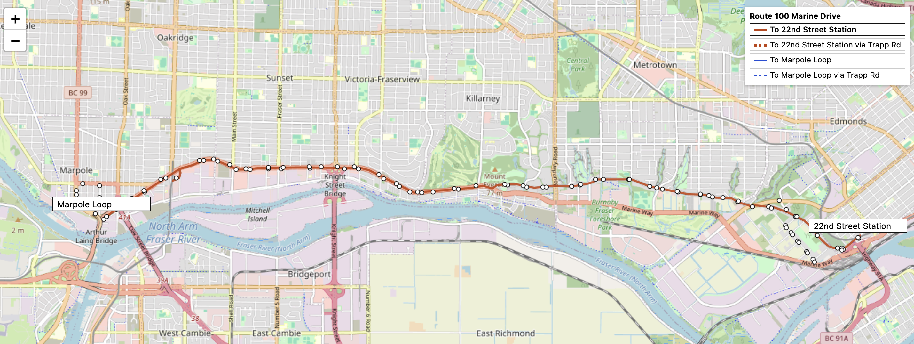
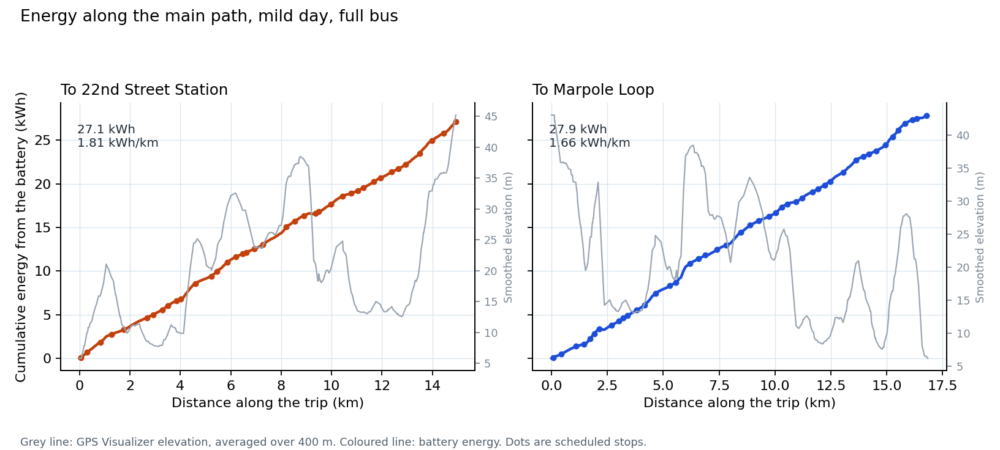
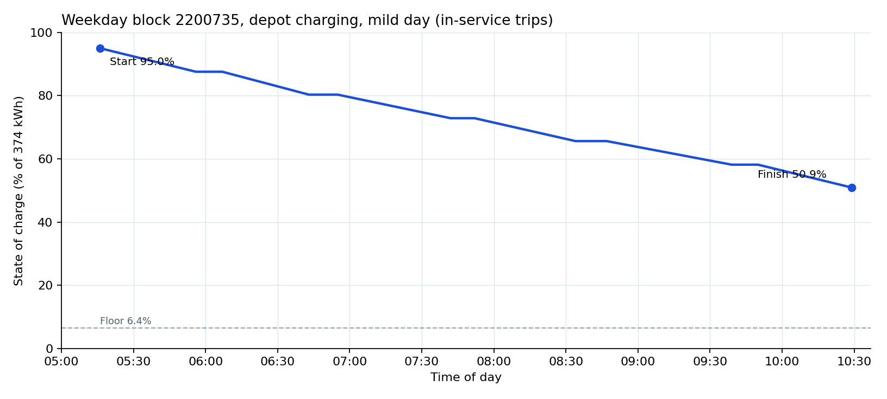
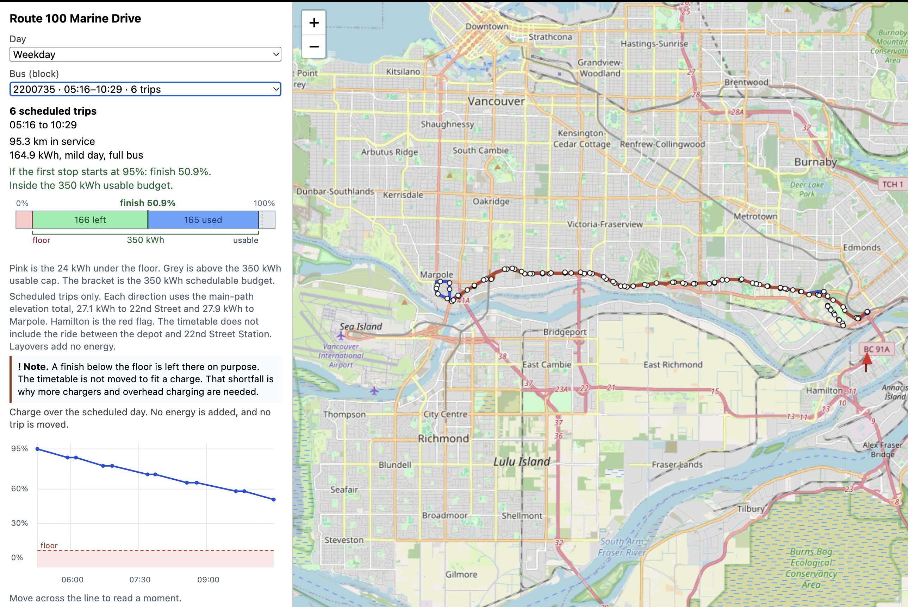

# Route 100 Battery-Electric Bus Energy Model

Energy and charging model for battery-electric buses on TransLink **Route 100** (Marine Drive), prepared as a take-home assignment for Coast Mountain Bus Company (CMBC).

**Rendered report:** [`output/energy_model.pdf`](output/energy_model.pdf)

The Quarto report covers:

1. **Depot charging only** — trip energy from GTFS + elevation, then state of charge over a weekday block
2. **Overhead catenary charging** — wire length and shared-power scenarios for a smaller pack
3. **Scaling** — how the same model could run network-wide in Microsoft Fabric / Power BI

<p align="center">
  
</p>
<p align="center"><em>Route 100 main path and via Trapp variants between 22nd Street Station and Marpole Loop</em></p>

---

## Highlights

| Energy along the route | Weekday state of charge |
|:----------------------:|:-----------------------:|
|  |  |

<p align="center">
  
</p>
<p align="center"><em>Interactive bus-day dashboard (weekday block 2200735) — map, usable energy budget, and SoC path</em></p>

---

## Repository layout

```text
.
├── energy_model.qmd          # Quarto report (source)
├── _quarto.yml               # Sends renders to output/
├── assets/                   # Figures used in the report
├── route_100/                # Python pipeline + processed Route 100 data
│   ├── extract_route_100.py  # Filter GTFS → trip / stop-time CSVs
│   ├── map_route_100.py      # GeoJSON + Leaflet route map
│   ├── energy_figures.py     # Energy model, figures, energy_summary.json
│   ├── bus_day_map.py        # Interactive bus-day dashboard
│   ├── data/
│   ├── figures/
│   └── maps/
├── data/
│   ├── google_transit/       # TransLink GTFS static feed
│   └── charging/             # Charging curve inputs
├── demos/                    # Interactive HTML maps / dashboards
├── presentation/             # Slide deck
└── output/                   # Rendered PDF (and HTML if you build it)
```

---

## Render the Quarto report

### Requirements

- [Quarto](https://quarto.org/docs/get-started/) CLI
- A PDF engine (e.g. TinyTeX): `quarto install tinytex`
- Python 3 + Matplotlib only if you regenerate figures: `pip install -r requirements.txt`

### Commands

From the project root:

```bash
# PDF
quarto render energy_model.qmd --to pdf

# HTML
quarto render energy_model.qmd --to html

# Both
quarto render energy_model.qmd
```

`_quarto.yml` writes outputs to `output/` (not next to `energy_model.qmd`). A pre-rendered PDF is already included there.

---

## Interactive demos

Open in a browser (no server required):

| Demo | File |
|------|------|
| Route map | [`demos/route_100_map.html`](demos/route_100_map.html) |
| Bus-day energy / SoC dashboard | [`demos/route_100_bus_day.html`](demos/route_100_bus_day.html) |

Regenerate after updating energy outputs:

```bash
python route_100/energy_figures.py
python route_100/bus_day_map.py
```

---

## Rebuild the modeling pipeline (optional)

Processed Route 100 extracts are already in `route_100/data/`. To rebuild from GTFS:

```bash
# Place a full TransLink google_transit feed in data/google_transit/
# (must include stop_times.txt)
python route_100/extract_route_100.py
python route_100/map_route_100.py

# After attaching elevation (GPX) for the main-path shapes:
python route_100/energy_figures.py
python route_100/bus_day_map.py
```

Elevation for the two main-path shapes was obtained with [GPS Visualizer](https://www.gpsvisualizer.com/elevation) and saved as `route_100/data/route_100_main_routes_elevation.gpx`.

Model assumptions (pack size, level-road rate, drive efficiency, etc.) are declared once at the top of `route_100/energy_figures.py` and written into `energy_summary.json` for the dashboard.

---

## Data sources

- TransLink [GTFS static data](https://www.translink.ca/about-us/doing-business-with-translink/app-developer-resources/gtfs/gtfs-data)
- GPS Visualizer elevation lookup
- Charging curves under `data/charging/`

---

## Author

**Grigory Artazyan** — November 2026
