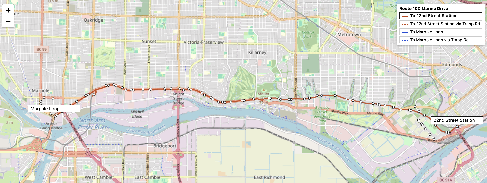
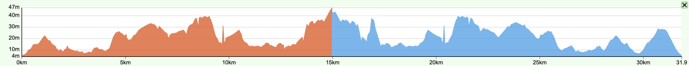
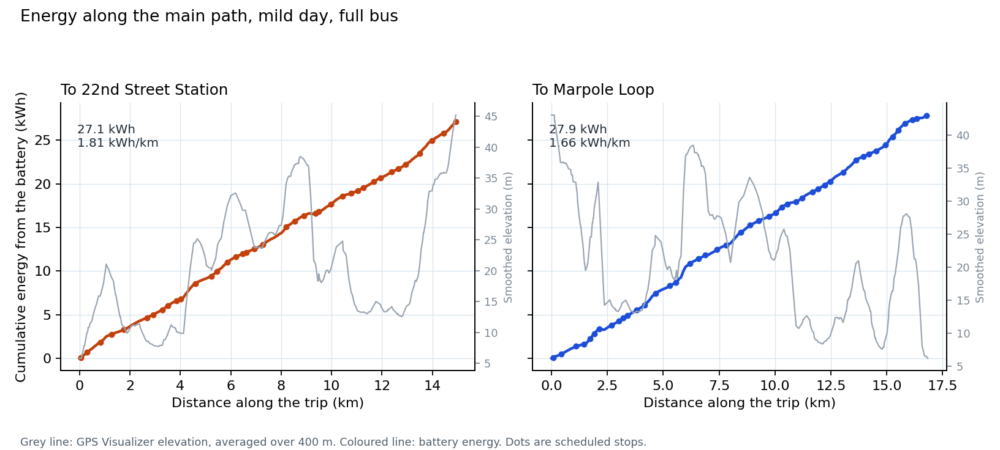
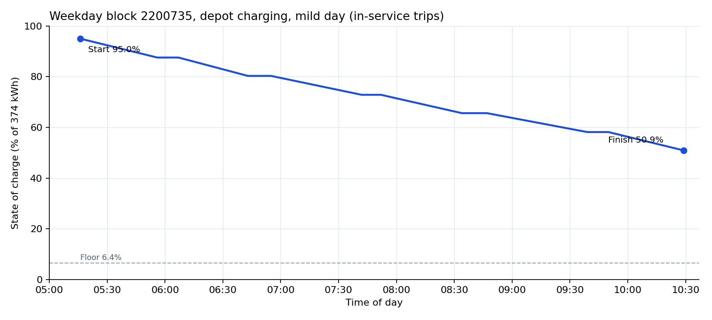
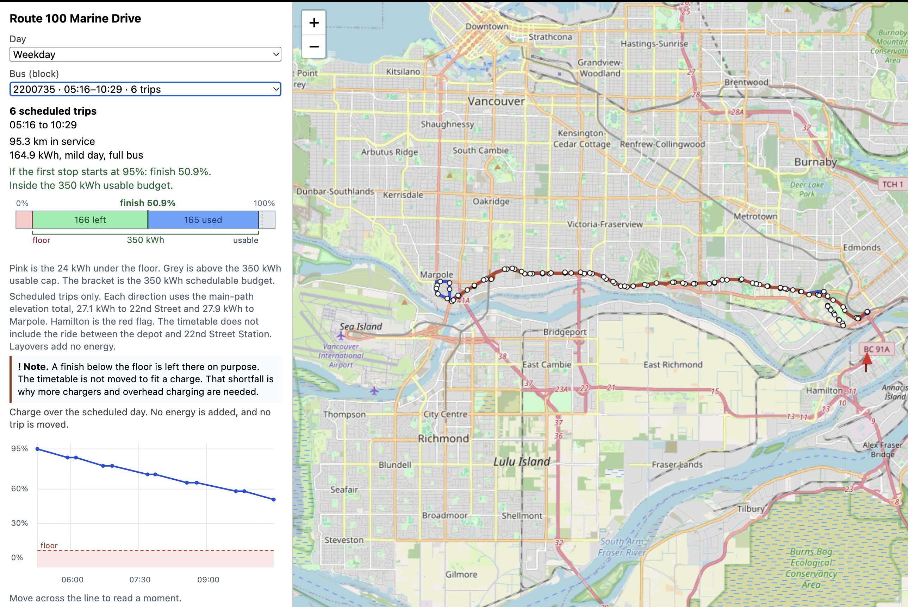
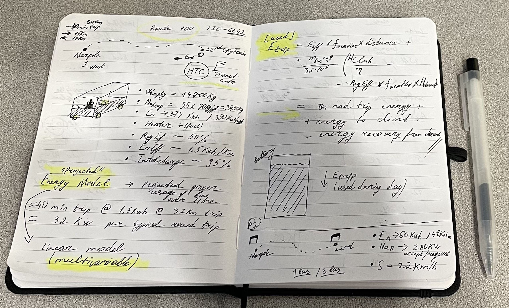

# Introduction {.unnumbered}

Coast Mountain Bus Company (CMBC) is moving its diesel and hybrid bus fleet to battery-electric buses. This report looks at battery-electric buses on TransLink Route 100 (Marine Drive). The bus starts at Hamilton Transit Centre depot. In service, it runs between 22nd Street SkyTrain Station and Marpole Loop, and it returns to Hamilton at the end of the day. @fig-map shows the route.[^figmap]

{#fig-map width=92%}

Throughout this report, I develop an energy model for the projected energy use of Bus 100. The model considers one trip, states the assumptions and variables, and calculates average energy use in kWh/km. I then carry the same process through the bus's scheduled day to monitor its state of charge accordingly.

In **Part 1**, I assume Hamilton Transit Centre (HTC) is the only charging depot.[^part1depot]

In **Part 2**, buses can charge during part of their route using an overhead catenary system.[^part2wire]

In **Part 3**, I describe how to implement and scale the model across the CMBC network using the existing Microsoft stack.

Together, these three parts move from developing and testing the energy model to exploring how it could be implemented and scaled in practice.

# Part 1 — Depot charging only {.unnumbered}

```{=latex}
\setcounter{section}{1}
\setcounter{subsection}{0}
```

## Data and route selection

### Where the data comes from

The schedule data comes from TransLink's General Transit Feed Specification (GTFS) package.[^gtfs] GTFS is a standard format. A transit agency publishes its planned service as a set of plain text tables that link to each other through shared IDs within GTFS format with txt files.[^gtfsspec]

A GTFS feed is a planned schedule. It does not record GPS positions, energy use, or chargers. Those elements are further covered by the model. This work uses five GTFS tables: `routes.txt` (identifies routes such as Route 100), `trips.txt` (defines scheduled journeys), `stop_times.txt` (orders bus stops per trip and duration), `shapes.txt` (maps geographic road points), and `calendar.txt` (sets service days and date ranges).

### Filtering the bus network down to Route 100

The feed covers every mode TransLink publishes. Bus rows have `route_type` equal to 3.[^types] Inside the bus rows, Route 100 is one row in `routes.txt`. Its public short name is `100`, its long name is Marine Drive, and its internal `route_id` is 6642 for our database reference.

Since the dataset fits easily in my computer memory, I processed these flat text files using a Python pandas script instead of deploying a database server. The SQL query below illustrates the exact filtering logic I applied.

```sql
-- Step 1: find Route 100 by its public name, not by a fixed ID
SELECT route_id, route_short_name, route_long_name
FROM routes
WHERE route_type = 3
  AND route_short_name = '100';

-- Step 2: count scheduled trips per service pattern (gives 219, 179, and 166)
SELECT service_id, COUNT(*) AS trips
FROM trips
WHERE route_id = '6642'
GROUP BY service_id;

-- Step 3: Keep main-path trips only (exclude Trapp Road branch variants).
-- Modeling assumption: Simplifies the model by keeping 
-- route geometry uniform across all trips.
SELECT t.trip_id, t.service_id, t.direction_id, t.trip_headsign, t.block_id
FROM trips AS t
WHERE t.route_id = '6642'
  AND t.trip_headsign NOT LIKE '%via Trapp%'
```


The Route 100 information extracted was saved as CSV tables (for trips and stop times) alongside the longitude and latitude coordinates of the road path. Because standard GTFS shapes lack elevation ($z$-coordinates), I exported the two main-path alignments as GeoJSON files and processed them through GPS Visualizer's elevation tool.[^elevation] The tool returned GPX files enriched with terrain height along the route, providing the climb and descent profiles required by the energy model.


### Service schedule and route operations

The extracted GTFS feed covers a four-month schedule from 7 September 2026 to 3 January 2027. @tbl-service summarizes the daily trip and bus block counts, where a block represents one bus's full operating day.

| Service pattern | Days | Trips | Buses (blocks) |
|:----------------|:-----|------:|---------------:|
| Service 1 | Monday to Friday | 219 | 23 |
| Service 2 | Saturday | 179 | 10 |
| Service 3 | Sunday | 166 | 9 |
| **Total** | | **564** | **42** |

: Daily scheduled trips and bus blocks by service pattern. {#tbl-service}

Direction 0 runs to 22nd Street Station, about 15 km. Direction 1 runs to Marpole Loop, about 17 km. 

Although the feed includes four headsigns (two main-path and two via Trapp Road variants), the energy calculations evaluate only the main-path alignment since the example blocks run on it and both share the same endpoints.[^trapp] 

## Assumptions

@tbl-assumptions lists every input the model uses. Each value is stated once here, and later sections refer back to this table.

| Quantity | Symbol | Value | Note |
|:---------|:-------|------:|:-----|
| Empty bus mass | $m_{\text{empty}}$ | 14700 kg | Vehicle mass |
| Passenger mass | $m_{\text{pax}}$ | 70 kg each | 55 passengers |
| Full bus mass | $m$ | 18550 kg | $14{,}700 + 55 \times 70$ |
| Pack nameplate | $E_{\text{nom}}$ | 374 kWh | Full pack |
| Pack usable | $E_{\text{use}}$ | 350 kWh | Used for planning |
| Floor | $E_{\text{floor}}$ | 24 kWh | $374 - 350$; 6.42% of nameplate |
| Start of day | SoC$_0$ | 95% | 355.30 kWh on board; only 350 kWh of that is usable |
| Schedulable energy | $E_{\text{sched}}$ | 350 kWh | $\min(355.30,\ E_{\text{use}}) = 350$ |
| Level-road rate | $r_{\text{level}}$ | 1.50 kWh/km | Assumed to capture typical Vancouver urban driving and traffic signals |
| Drive efficiency | Drive | 0.85 | Assumed drivetrain efficiency converting battery output into climb energy |
| Regeneration efficiency | Regen | 0.50 | Assumed share of downhill potential energy recovered by the battery |
| Weather factor (mild) | $f_{\text{weather}}$ | 1.0 | Assumed baseline multiplier on level-road energy under mild weather |
| Downhill factor (mild) | $f_{\text{regen}}$ | 1.00 | Assumed baseline multiplier on downhill regenerative recovery under mild conditions |
| Weather factor (cold) | $f_{\text{weather}}$ | 1.10 | Assumed 10% energy penalty for cold (e.g. cold-morning conditions) |
| Downhill factor (cold) | $f_{\text{regen}}$ | 0.50 | Assumed 50% reduction in downhill regenerative recovery due to cold battery limits |
| Deadhead distance | $d$ | 4 km each way | Estimated off-route link between Hamilton depot and 22nd Street Station |

: Energy model parameters and operating assumptions. {#tbl-assumptions tbl-colwidths="[22,12,16,50]"}

Most of these parameters serve as modular inputs rather than fixed constants; adjusting any value to reflect empirical operating conditions leaves the underlying energy model intact.

## The energy model

This section gives the model in general form first. Calculations come after once the variables are plugged in.

### General form

A trip uses battery energy in three ways. It spends energy on level road. It spends extra energy to lift the bus up a hill. And it gets some energy back on the way down.

```{=latex}
\begin{formulabox}
\[
E_{\text{trip}} = E_{\text{level}} + E_{\text{climb}} - E_{\text{recover}}
\]
\end{formulabox}
```

Level-road energy depends on distance and weather factor. Here $D$ is the trip length in km:

```{=latex}
\begin{formulabox}
\[
E_{\text{level}} = r_{\text{level}} \, f_{\text{weather}} \, D
\]
\end{formulabox}
```

Climbing energy depends on total elevation gained ($H_{\text{up}}$ in metres). Lifting the bus mass ($m$) against gravity ($g$) requires potential energy equal to $m g H_{\text{up}}$, which is divided by drivetrain efficiency to account for battery losses and by $3.60 \times 10^{6}$ to convert joules to kilowatt-hours:[^kwh]

```{=latex}
\begin{formulabox}
\[
E_{\text{climb}} = \frac{m \, g}{3.60 \times 10^{6}} \cdot \frac{H_{\text{up}}}{\text{Drive}}
\]
\end{formulabox}
```

Recovered energy depends on total elevation lost ($H_{\text{down}}$ in metres). The potential energy released during descent ($m g H_{\text{down}}$) is multiplied by the regeneration efficiency ($\text{Regen}$) and scaled by the downhill weather factor ($f_{\text{regen}}$) to determine how much energy returns to the battery:

```{=latex}
\begin{formulabox}
\[
E_{\text{recover}} = \frac{m \, g}{3.60 \times 10^{6}} \cdot \text{Regen} \cdot f_{\text{regen}} \cdot H_{\text{down}}
\]
\end{formulabox}
```

Put together, the full model is

```{=latex}
\begin{formulabox}
\[
E_{\text{trip}} = r_{\text{level}} f_{\text{weather}} D + \frac{m g}{3.60 \times 10^{6}} \left( \frac{H_{\text{up}}}{\text{Drive}} - \text{Regen} \cdot f_{\text{regen}} \cdot H_{\text{down}} \right)
\]
\end{formulabox}
```

The model calculates energy for each GPS segment and sums them up, counting every hill right where it happens on the route (see @fig-energy).

### Grouping the constants

The mass, gravity, and unit factor only appear as one group. Call it $k_{\text{h}}$:

```{=latex}
\begin{formulabox}
\[
k_{\text{h}} = \frac{m g}{3.60 \times 10^{6}}
\]
\end{formulabox}
```

With $k_{\text{h}}$, the full formula becomes a simpler line that is easy to check by hand:

```{=latex}
\begin{formulabox}
\[
E_{\text{trip}} = r_{\text{level}} f_{\text{weather}} D + k_{\text{h}} \left( \frac{H_{\text{up}}}{\text{Drive}} - \text{Regen} \cdot f_{\text{regen}} \cdot H_{\text{down}} \right)
\]
\end{formulabox}
```

### Plugging in the numbers

Now the values from @tbl-assumptions go in.

The energy needed to lift the bus by one metre is:

```{=latex}
\begin{formulabox}
\[
\begin{aligned}
m g \cdot 1\,\text{m} &= 18550 \times 9.81 \times 1 = 181975.50\ \text{J} \\
\frac{181975.50}{3.60 \times 10^{6}} &= 0.050549\ \text{kWh per metre}
\end{aligned}
\]
\end{formulabox}
```

Dividing by Drive gives the energy the battery spends per metre of climb. 
Multiplying by Regen gives the energy it gets back per metre of descent:

```{=latex}
\begin{formulabox}
\[
\begin{aligned}
\text{per metre of climb} &= \frac{0.050549}{0.85} = 0.05947\ \text{kWh/m} \\
\text{per metre of descent} &= 0.050549 \times 0.50 = 0.02527\ \text{kWh/m}
\end{aligned}
\]
\end{formulabox}
```

The working form of the model is

```{=latex}
\begin{formulabox}
\[
E_{\text{trip}} = 1.50 \, f_{\text{weather}} \, D + 0.05947 \, H_{\text{up}} - 0.02527 \, f_{\text{regen}} \, H_{\text{down}}
\]
\end{formulabox}
```

Each term is easy to read. The first is the flat-road energy consumption cost. The second is the climb. The third is regenerative energy downhill.

## Calculations and results

### One crossing on a mild day, full bus

The worked trips use mild weather, so $f_{\text{weather}} = 1$ and $f_{\text{regen}} = 1$. The grade/elevation comes from the smoothed GPS track.

#### Toward 22nd Street Station

The trip is 14.93 km long, with 108.10 m of climb and 68.80 m of descent. The three pieces are

$$
\begin{aligned}
E_{\text{level}} &= 1.50 \times 1 \times 14.93 = 22.40\ \text{kWh} \\
E_{\text{climb}} &= 0.05947 \times 108.10 = 6.43\ \text{kWh} \\
E_{\text{recover}} &= 0.02527 \times 68.80 = 1.74\ \text{kWh}
\end{aligned}
$$

Adding them with the three-piece split gives

```{=latex}
\begin{formulabox}
\[
E_{\text{trip}} = 22.40 + 6.43 - 1.74 = 27.09\ \text{kWh}
\]
\end{formulabox}
```

The average for the track is

$$
\frac{27.09}{14.93} = 1.81\ \text{kWh/km}
$$

#### Toward Marpole Loop

The track is 16.84 km long, with 104 m of climb and 140.80 m of descent. Here the descent is larger than the climb, so the downhill regenerated energy credit is bigger:

$$
\begin{aligned}
E_{\text{level}} &= 1.50 \times 1 \times 16.84 = 25.26\ \text{kWh} \\
E_{\text{climb}} &= 0.05947 \times 104 = 6.19\ \text{kWh} \\
E_{\text{recover}} &= 0.02527 \times 140.80 = 3.56\ \text{kWh}
\end{aligned}
$$

```{=latex}
\begin{formulabox}
\[
E_{\text{trip}} = 25.26 + 6.19 - 3.56 = 27.88\ \text{kWh}
\]
\end{formulabox}
```

The energy file reports 27.88 kWh after summing every smoothed step, so the report uses 27.88 kWh. The average is

$$
\frac{27.88}{16.84} = 1.66\ \text{kWh/km}
$$

@fig-elev illustrates the elevation profile for a complete round trip, highlighting the net elevation change between terminals. 


{#fig-elev width=100%}


@fig-energy tracks the resulting cumulative battery draw across both directions, showing how this net climb makes the eastbound trip noticeably more energy-intensive per kilometre (1.81 kWh/km) than the return leg (1.66 kWh/km).

{#fig-energy width=100%}


### Cold-Weather Impact on Energy Demand

A cold weather (e.g. cold morning) changes two things. Level-road energy is assumed to rise by 10% ($f_{\text{weather}} = 1.10$). The downhill energy regeneration credit is halved ($f_{\text{regen}} = 0.50$). Climb does not change.

For the 22nd Street leg:

$$
\begin{aligned}
E_{\text{level}} &= 1.50 \times 1.10 \times 14.93 = 24.64\ \text{kWh} \\
E_{\text{recover}} &= 0.02527 \times 0.50 \times 68.80 = 0.87\ \text{kWh}
\end{aligned}
$$

```{=latex}
\begin{formulabox}
\[
E_{\text{trip}} = 24.64 + 6.43 - 0.87 = 30.20\ \text{kWh}
\]
\end{formulabox}
```

For the Marpole leg:

$$
\begin{aligned}
E_{\text{level}} &= 1.50 \times 1.10 \times 16.84 = 27.78\ \text{kWh} \\
E_{\text{recover}} &= 0.02527 \times 0.50 \times 140.80 = 1.78\ \text{kWh}
\end{aligned}
$$

```{=latex}
\begin{formulabox}
\[
E_{\text{trip}} = 27.78 + 6.19 - 1.78 = 32.19\ \text{kWh}
\]
\end{formulabox}
```

The early morning cold first loop average is:

$$
\frac{30.20}{14.93} = 2.02\ \text{kWh/km}
$$

$$
\frac{32.19}{16.84} = 1.91\ \text{kWh/km}
$$

Comparing these rates against the mild-weather baseline ($1.81$ and $1.66\ \text{kWh/km}$) leads to:

$$
\frac{2.02 - 1.81}{1.81} = +11.6\% \quad \text{and} \quad \frac{1.91 - 1.66}{1.66} = +15.1\%
$$

Most of that change comes from the downhill credit on the Marpole leg, which has the longer descent. The 11% and 15% are large enough margins to matter for a planning margin.

Both weather factors are placeholders in this simulation case. A later weather feed can set them for each trip day. The three-part projected energy model does not change.[^cold]

## State of charge

### The rule

State of charge (SoC) is expressed as a percentage of the 374 kWh nameplate capacity, decreasing with the energy consumed on each trip:

```{=latex}
\begin{formulabox}
\[
\text{SoC}_{\text{new}} = \text{SoC} - \frac{E_{\text{trip}}}{374} \times 100
\]
\end{formulabox}
```

Usable battery capacity is bounded by a 24 kWh top buffer ($374 - 350 = 24\ \text{kWh}$, capping the upper bound around $95\%$). At a 95% start the pack holds 355.30 kWh, but only the usable 350 kWh counts for planning, so $E_{\text{sched}} = 350$ kWh. By symmetry, the same 24 kWh margin is assumed as a lower-bound reserve floor ($24 / 374 \times 100 = 6.42\%$, or $\approx 6\%$). While the bus is parked at a terminal, no movement occurs, so SoC remains unchanged.


### Worked example: block 2200735

Block 2200735 is the median weekday duty by distance. It has six main-path trips, three in each direction, covering 95.30 km of service between about 05:16 and 10:29. 

The service day begins at an initial SoC of 95% (355.30 kWh on board; 350 kWh usable for planning). @tbl-soc tracks the in-service battery trajectory for the six main-path trips, matching the dashboard view. Pull-out and pull-in deadheads to Hamilton are excluded here (about 12 kWh together) so the finish aligns with the live tool.

| Time | Movement | Energy used (kWh) | Total used (kWh) | Energy left (kWh) | SoC |
|:-----|:---------|------:|------:|------:|------:|
| 05:16 to 05:56 | To Marpole Loop, then parked | 27.88 | 27.88 | 327.42 | 87.55% |
| 06:07 to 06:43 | To 22nd Street, then parked | 27.09 | 54.97 | 300.33 | 80.30% |
| 06:55 to 07:42 | To Marpole Loop, then parked | 27.88 | 82.85 | 272.45 | 72.85% |
| 07:52 to 08:34 | To 22nd Street, then parked | 27.09 | 109.94 | 245.36 | 65.60% |
| 08:47 to 09:39 | To Marpole Loop, then parked | 27.88 | 137.82 | 217.48 | 58.15% |
| 09:50 to 10:29 | To 22nd Street | 27.09 | 164.91 | 190.39 | 50.90% |

: State-of-charge (SoC) trajectory across weekday block 2200735 (in-service only). {#tbl-soc}

The six trips use $3 \times 27.09 + 3 \times 27.88 = 164.91$ kWh. The energy left is $355.30 - 164.91 = 190.39$ kWh, so

$$
\frac{190.39}{374} \times 100 = 50.90\%
$$


@fig-soc shows the same path as a line.[^figsoc] The flat steps are layovers, and the slopes are trips.

{#fig-soc width=92%}

The block finishes at **50.9% SoC**, which is about 44.5 percentage points above the 6.42% floor. It clears the floor with room to spare and stays inside the 350 kWh usable budget.


Even though these results reflect conservative worst-case assumptions (a fully loaded bus across the entire block), a 6.42% reserve floor leaves too little operational margin for unexpected detours, traffic delays, or battery degradation. Adopting the more conservative ~40% minimum threshold established in Part 2, the bus still completes weekday block 2200735. But do other scheduled blocks? Turns out not all of them.


## Longer duties

Extended daily blocks exceed single-charge capacity and require either a mid-day return to Hamilton depot or on-route overhead charging before completing scheduled service.[^fleet] @fig-dashboard presents a unified planning view of weekday block 2200735, pairing the Route 100 alignment with the daily energy budget and state-of-charge trajectory. The dashboard finish of **50.9%** matches the in-service worked example above.

{#fig-dashboard width=92%}

> **Note:** A live demo of the interactive dashboard will be presented during the interview to walk through the methodology and explore the underlying scenarios shown in the figure above.

\newpage

# Part 2 — Overhead catenary charging {.unnumbered}

```{=latex}
\setcounter{section}{2}
\setcounter{subsection}{0}
```

Part 1 assumes no charge between terminals. Part 2 asks whether a smaller battery pack onboard, held at minimum threshold of 40% state of charge, can run indefinitely if the bus picks up energy from an overhead wire on parts of the route.

The trip energy from Part 1 does not change. The wire only adds energy on the stretches it covers.

## The pack and the charging curve

The pack is 60 kWh in total. The floor is 40% of it, which is 24 kWh. The usable energy of the pack is 48 kWh. For repeating in-service loops, the pack is held in a tighter 40%–65% band, which is 15 kWh ($0.65 \times 60 - 0.40 \times 60$).

The overhead charging curve can deliver 280 kW from 15% to 65% state of charge, then 140 kW from 65% to 85%. It stops accepting charge at 90%. The catenary supplies 280 kW in total, shared equally by the buses on the wire at that moment. 

The average speed under the wire is 22 km/h. 

## The time and length equations

To find how much overhead wire is needed, we calculate how long the bus must stay connected to replace its lost energy, then multiply that time by the bus's speed:

```{=latex}
\begin{formulabox}
\[
t = \frac{E_{\text{trip}}}{P}, \qquad L = v \, t
\]
\end{formulabox}
```

Here:

- $E_{\text{trip}}$ = energy to replace ($\text{kWh}$)
- $P$ = net charging power delivered to the battery ($\text{kW}$)
- $t$ = required connection time ($\text{hours}$)
- $v$ = average bus speed while charging ($22\ \text{km/h}$)
- $L$ = required overhead wire length ($\text{km}$)

## One bus under the wire

One bus takes the full 280 kW. Toward 22nd Street Station:

$$
t = \frac{27.09}{280} \times 60 = 5.81\ \text{min}, \qquad L = 22 \times \frac{5.81}{60} = 2.13\ \text{km}
$$

Toward Marpole Loop:

$$
t = \frac{27.88}{280} \times 60 = 5.98\ \text{min}, \qquad L = 22 \times \frac{5.98}{60} = 2.19\ \text{km}
$$

Together the two crossings need 11.78 min of charging and 4.32 km of wire.

A single strip of wire leaves a long bare gap. On the 22nd Street leg, the bare part is $14.93 - 2.13 = 12.80$ km. At 1.81 kWh/km that gap uses $12.80 \times 1.81 = 23.23$ kWh. That is more than the 15 kWh the pack can give between 65% and 40%. The rule for each bare gap is therefore

```{=latex}
\begin{formulabox}
\[
E_{\text{gap}} = \text{km}_{\text{gap}} \times (\text{kWh/km}) \le 15\ \text{kWh}
\]
\end{formulabox}
```

Using that rule, the bare gap toward 22nd Street must stay under $15 / 1.81 = 8.27$ km, and the gap toward Marpole under $15 / 1.66 = 9.06$ km. Splitting the wire into two or more pieces on each leg keeps every gap under those limits.

## Three buses under the wire

Three buses share the catenary, so each receives

$$
P = \frac{280}{3} = 93.33\ \text{kW}
$$

Toward 22nd Street Station:

$$
t = \frac{27.09}{93.33} \times 60 = 17.41\ \text{min}, \qquad L = 22 \times \frac{17.41}{60} = 6.39\ \text{km}
$$

Toward Marpole Loop:

$$
t = \frac{27.88}{93.33} \times 60 = 17.93\ \text{min}, \qquad L = 22 \times \frac{17.93}{60} = 6.57\ \text{km}
$$

Together: 35.34 min of charging and 12.96 km of wire. A single piece on each leg now leaves bare gaps of $14.93 - 6.39 = 8.55$ km, which uses 15.50 kWh, and $16.84 - 6.57 = 10.27$ km, which uses 17 kWh. Both are a little over 15 kWh but well inside the 27 kWh the pack holds between 40% and 85%, so the refill still finishes on the charging curve.

## Where the wire should go

The total length is set by energy and power. Its placement is chosen from the elevation profile. SoC falls fastest on the climbing hills. The net rise toward 22nd Street Station adds 4.69 kWh of grade, and the rise near Granville on the way to Marpole adds the next largest cost. Those are the stretches that would belong under the wire. 

## The limit on how many buses can share

At peak, buses run about 2 km apart. If the wire pieces are longer than that spacing, or two buses are under the wire at the same minute, the share drops toward 140 kW.

Ten buses on the wire would each get $280 / 10 = 28$ kW. Motors use about 36 to 40 kW on a trip, so at that share no length of wire closes the loop. A short cluster on the steepest part of each leg keeps the count of buses under the wire low.

\newpage

# Part 3 — Scaling across the CMBC network {.unnumbered}

```{=latex}
\setcounter{section}{3}
\setcounter{subsection}{0}
```

## Accessing the data through Microsoft Fabric

Parts 1 and 2 were prototyped in a local development environment (Cursor/VS Code) using flat files for Route 100. Scaling this analysis across the full Coast Mountain Bus Company (CMBC) network requires moving from local scripts to a centralized, repeatable cloud pipeline.

Here, I outline how Microsoft Fabric can run the same model at scale and share results via Power BI dashboards (@fig-flow) and other tools.

::: {#fig-flow fig-cap="Proposed Microsoft Fabric data architecture for network-wide energy modeling."}

```
GTFS + elevation + weather + (other variables later)
            |
            v
   Fabric pipeline (copy energy model)
            |
            v
   OneLake Bronze (includes raw files)
            |
            v
   Notebook clean / join (python/sql)  -->  Silver tables
                                    |
                    +---------------+---------------+
                    v                               v
           SQL checks / EDA              Use energy model
                                                    |
                                                    v
                                             Gold tables
                                                    |
                                                    v
                                         Power BI dashboards and other tools
```

:::

The steps in plain words:

1. **Load.** A pipeline copies the GTFS tables and the elevation files into the lakehouse as they are. These raw copies are never edited.
2. **Clean.** A notebook filters the feed by `route_type` and `route_short_name`, the same way the SQL in Part 1 does, and writes silver tables.
3. **Check.** The SQL endpoint runs quick checks, such as trip counts per service pattern. These should match the counts in @tbl-service.
4. **Model.** A second notebook runs the trip energy and state-of-charge steps and writes gold tables.
5. **Show.** Power BI reads the gold tables and shows the metrics and energy rate of change graphs.


## Exploring the rest of the CMBC network

The Route 100 pipeline can be repeated for every route. The scale-up plan has three strands.

- **SQL** on the silver tables for counts, such as trips per route per service pattern, stops per route, and block lengths.
- **Python** (pandas, matplotlib, geopandas) for distributions, such as trip length, climb per trip, and elevation profile shape across routes.
- **Repeat** the same notebook for each `route_id`, so every route gets the same checks.

Some things to watch. Route variants and shapes must be handled the way the via Trapp Road shapes were handled here. Timing gaps between stops need the same care. 

## Key metrics and dashboards

Some of the metrics are:

- Energy per kilometre, by route and by day.
- The lowest state of charge on each block, compared with the floor.
- The share of blocks that exceed the schedulable budget, by service pattern.
- Wire length and the power each bus receives, for any overhead segment.

Power BI works well for these numbers. Maps of the route are harder to keep clear in Power BI, so geometry can stay in GeoJSON that links to the same lakehouse.

## Limits of this work

- **Projection, not measurement.** The energy numbers come from a planned schedule and a multivariable linear model. 
- **Placeholder rates.** The 1.50 kWh/km level-road rate and the 0.85 Drive value are assumptions. 
- **No winter data.** The cold-morning factors of 1.10 and 0.50 are planning values. They are not a measured winter result for this bus and are optimistic assumptions.
- **Depot not in the feed.** Hamilton Transit Centre is not a stop in GTFS, so the 4 km deadhead is an approximation.

# Conclusion {.unnumbered}

For Route 100, one crossing uses 27.09 kWh toward 22nd Street Station and 27.88 kWh toward Marpole Loop. Toward 22nd Street Station the average is 1.81 kWh/km, and toward Marpole Loop it is 1.66 kWh/km. 

The 8 of 23 weekday blocks, 8 of 10 Saturday blocks, and 7 of 9 Sunday blocks need more energy than one morning HTC charge can give (against the 350 kWh usable budget). Depot charging alone does not cover the longer duties. An overhead wire on the climbs is one option. The model shows that about 13 km of wire could keep a smaller pack of 3 buses operating above battery thresholds of 40%.

[^part1depot]: The bus recharges only at Hamilton; Marpole Loop and 22nd Street Station are parking locations where it waits during scheduled gaps, with no change in state of charge. As shown later, this approach would not support smooth transit operations: some buses would run out of charge mid-service and need several hours to recharge.
[^part2wire]: The same model developed in Part 1 applies; however, to run indefinitely, a bus must pick up energy from the overhead wire. The wire adds energy only along the stretches it covers. Given additional assumptions, I calculate how much charging time is necessary, the minimum wire length required, and where the wire should be placed. I consider one-bus and three-bus scenarios, with a maximum charging rate of 280 kW per bus.
[^figmap]: Orange = toward 22nd Street Station; blue = toward Marpole Loop. Solid lines are the main path; dashed lines are via Trapp Road variants. White dots are stops. Hamilton Transit Centre lies south of the east end of the route and is not on the in-service line.
[^figsoc]: Flat steps are layovers at Marpole Loop and 22nd Street Station. The bus starts at 95% and finishes at 50.9% on the in-service trips, above the 6.42% floor. The chart label “home charging only” is the same mode this report calls depot charging.
[^gtfs]: TransLink. General Transit Feed Specification (GTFS) package, `google_transit`. [https://www.translink.ca/about-us/doing-business-with-translink/app-developer-resources/gtfs/gtfs-data]
[^gtfsspec]: GTFS Schedule Reference. https://gtfs.org/documentation/schedule/reference/
[^types]: In this feed, `route_type` 3 is bus, with 232 routes. Other codes are 1 for subway (Canada Line, Millennium Line, Expo Line), 2 for rail (West Coast Express), 4 for ferry (SeaBus), and 715 for demand-responsive bus (HandyDART).
[^elevation]: GPS Visualizer. Elevation tool. https://www.gpsvisualizer.com/elevation. The two main-path shapes were uploaded as GeoJSON, returning GPX files with elevation data (in metres) appended to each coordinate point.
[^trapp]: The via Trapp Road variants are real scheduled routings. They are kept in the extract and drawn on the map. Their length is not measured, so the energy totals in this report refer only to the main path. A future version should measure them.
[^kwh]: One kilowatt-hour is $3.60 \times 10^{6}$ joules (the SI definition of the joule as kg·m²/s²). https://www.bipm.org/en/publications/si-brochure
[^cold]: The weather factors 1.10 and 0.50 are planning values for a near-freezing Richmond morning. They stand in for a later join to weather data for the day of the trip.
[^fleet]: The same mild-case accounting was applied to every block. This is a planning projection built from GTFS and assumed rates. It is not a statistical confidence interval, and it is not a measured result.

## Notes on the process {.unnumbered .unlisted}

The model was built from the bottom up. Bus mass, pack size, level-road rate, regeneration, and weather were written as separate inputs first. Then they were combined into the trip formula. Topography was taken from GPS Visualizer on the main-path shapes, so climb and descent were measured on a track. Bus drivers were interviewed about layovers, pull-out, and the day-end return, so the schedule extract matches how the day actually runs. @fig-notes shows the early working notes from brainstorming.

{#fig-notes width=92%}

\newpage

## Sources {.unnumbered .unlisted}

```{=latex}
\begingroup
\raggedright
\sloppy
\setlength{\parindent}{-1.5em}
\setlength{\leftskip}{1.5em}
\setlength{\parskip}{0.65em}
```

::: {.apa-refs}
Coast Mountain Bus Company. (n.d.). *About Coast Mountain Bus Company*. <https://www.coastmountainbus.com/>

Ebusco. (n.d.). *The power of regeneration*. <https://www.ebusco.com/power-of-regeneration/>

Google. (n.d.). *GTFS static overview*. Google for Developers. <https://developers.google.com/transit/gtfs>

MobilityData. (n.d.). *GTFS schedule reference*. General Transit Feed Specification. <https://gtfs.org/documentation/schedule/reference/>

Posit. (n.d.). *Quarto documentation*. <https://quarto.org/docs/>

Schneider, A. (n.d.). *GPS Visualizer: Look up elevations*. GPS Visualizer. Retrieved November 17, 2026, from <https://www.gpsvisualizer.com/elevation>

TransLink. (n.d.-a). *GTFS static data (google_transit)* [Data set]. Retrieved November 17, 2026, from <https://www.translink.ca/about-us/doing-business-with-translink/app-developer-resources/gtfs/gtfs-data>

TransLink. (n.d.-b). *Route 100 schedule and map*. <https://www.translink.ca/schedules-and-maps/route/100/direction/1/map?pageSize=5>

TransLink. (2023, February 21). *TransLink begins battery-electric bus fleet expansion*. <https://www.translink.ca/news/2023/february/translink%20begins%20battery-electric%20bus%20fleet%20expansion>
:::

```{=latex}
\endgroup
```
